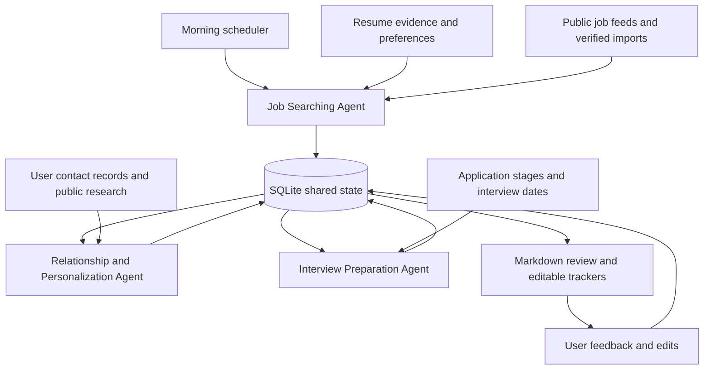

# Architecture and next steps

The orchestrator runs source requests concurrently and passes durable records between agents. Agents are separate Python modules with testable contracts, not three unconstrained chat sessions. Model-backed public research is optional. Human review controls sending, applications, and final resume edits; this program contains no message-sending or application-submission tool.

`jobs`, `source_health`, `packets`, `contacts`, `applications`, `interviews`, `tasks`, `research`, `candidates`, and `schedule` are versionable JSON records in SQLite. Every record has stable identity and created/updated timestamps. Agent failures remain visible in the `runs` table. Reports are replaceable projections of that state; imports preserve task metadata and user completion.

## Suggested improvements, in order

1. **Feedback and selection.** Add interested/dismissed reasons (wrong domain, level, location, compensation, company). Use these as training signals for ranking. Run costly relationship research on the best few saved roles rather than every broad match.
2. **Contact graph.** Import your LinkedIn connections export and your own recorded introduction paths. Model candidate → known contact → public lead → team → role, with source, verification date, and confidence per edge. Exported first-degree connections cannot prove second-degree paths without additional evidence.
3. **Compensation evidence.** Maintain separately sourced company/level/location bands, date, base, annualized equity, bonus, and confidence. Levels.fyi is a source of estimates; recruiter confirmation establishes role-specific expectations. Avoid hard rejection from an unknown package or an incomplete base range. Equity liquidity and annualization need separate treatment.
4. **Calendar connection and adaptive prep.** Connect a calendar selected by the user, deduplicate by event ID, and handle time-zone changes/cancellations. Record correctness, completion time, and confidence per practice topic; prioritize weaknesses with spaced repetition and deadline-aware mocks.
5. **A review dashboard.** Add a local interface over SQLite for job review, relationship evidence, resume comparisons, and drag-to-reschedule practice. The current Markdown + CSV workflow keeps storage usable before a UI is chosen.

## Automatic discovery design

Discovery should be a bounded exploration loop, not an unrestricted crawler:

1. Generate searches from evidenced strengths: C++ RPC/data plane, observability, distributed storage, API infrastructure, GPU networking. Follow relevant jobs in public aggregators, open-source project ecosystems, conference speaker affiliations, and engineering blogs.
2. Extract candidate company and job URLs. Deduplicate aliases and identify official employer ownership. Search snippets alone are not proof of an open role.
3. Resolve a public ATS board from the official careers site. Validate scheme/domain, connector schema, company identity, pagination, and a successful complete response. Never turn arbitrary third-party URLs into authenticated requests.
4. Sample the board and measure qualified Bay Area/US-remote roles, skill overlap, freshness, and available compensation evidence. Keep fit and compensation confidence separate.
5. After explicit enabling of automatic discovery, allow a small number of validated subscriptions per week (for example 3), record why each was added, and immediately include its jobs in the normal pipeline. The current implementation stops at a reviewable candidate brief and manual `source-add`.
6. Review yield over several weeks. Reduce polling for low-yield sources, quarantine broken connectors, and offer unsubscribe recommendations. A positive user save/referral/interview is a stronger reward than raw posting count.

## Current boundaries

- Live ATS feeds are implemented; Meta/LinkedIn/Levels.fyi automatic connectors, private network lookup, and calendar sync are not.
- Model output is sourced research, not an automatically verified contact graph or a resume fact source.
- Resume drafts select and reorder grounded achievements. They are review Markdown, not publication-ready PDF/LaTeX replacements.
- Generic preparation is usable without an interview schedule. Past company questions require dated, accessible firsthand sources and remain anecdotal.
- No email is sent, no application is submitted, and the upstream resume repository is not modified.
- SQLite and local files suit a personal workflow. An always-on multi-user service would need a server database, durable task queue, authentication, scheduled workers, and a secrets manager.
