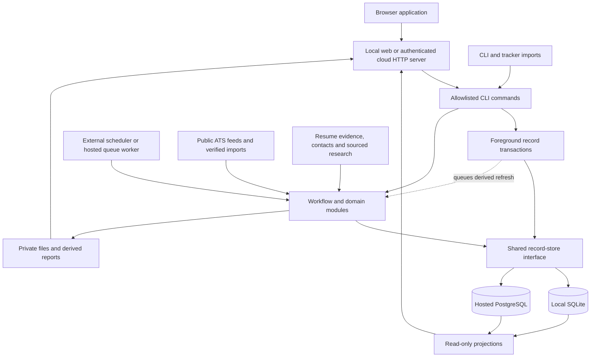

# Architecture and next steps

Jobflow shares one Python workflow core between a local CLI, a browser application, and an invite-only hosted deployment. The four agents are ordinary Python modules with testable contracts: job search, relationships and personalization, interview preparation, and daily coaching. Model-backed research is optional. Python 3.9+ and the standard library run the backend; the browser uses bundled HTML, CSS, JavaScript, fonts, and third-party map/PDF libraries without a frontend build step.

## Runtime architecture

Local and hosted storage are alternative backends, not two databases continuously synchronized with each other. The browser is a presentation and review surface. Validation, matching, scheduling, submission state, and persistence remain in the Python core. Workflow-record actions pass through the CLI; hosted authentication, onboarding/configuration, onboarding uploads, and queue operations use their HTTP-owned adapters. Reads do not launch the CLI: `web._read_records` opens SQLite read-only or delegates to `remote_store.read_records`.

| Layer | Main implementation | Responsibility |
| --- | --- | --- |
| Browser | `jobflow/web_assets/` | Company/role exploration, inbox, analytics/maps, account history, applications, batches, resumes, connections, and preparation. |
| Local HTTP transport | `jobflow/web.py` | Loopback server, read projections, private downloads, static assets, and bounded allowlisted action dispatch. |
| Hosted HTTP transport | `jobflow/cloud.py`, `cloud_auth.py`, `cloud_accounts.py`, `onboarding.py` | Email identity, invitation checks, application sessions, workspace routing, reviewed onboarding, and queueing. |
| Command boundary | `jobflow/cli.py`, `foreground.py`, `cloud_cli.py` | User commands, foreground action allowlist, workflow locking, imports/exports, and administrative operations. |
| Domain workflows | `workflow.py`, `sources.py`, `matching.py`, `relationships.py`, `preparation.py`, `coaching.py` | Feed ingestion, ranking, personalization, shared preparation budget, and recorded daily progress. |
| Plans and evidence | `agentic.py`, `preparation_guides.py`, `practice_resources.py`, `service_context.py`, `locations.py`, `salary_references.py` | Reviewed next-step proposals and dated evidence projections. |
| Materials and application runs | `application_batches.py`, `resumes.py`, `resume_reviews.py`, `resume_ai.py`, `codex_handoff.py`, `hosted_codex.py`, `hosted_codex_client.py` | Private resume versions, annotations, reviewed materials, and local/hosted Codex protocols. |
| Persistence | `storage.py`, `record_concurrency.py`, `remote.py`, `remote_store.py`, `remote_files.py` | SQLite or backend-only remote RPCs, atomic record checks, workflow leases, immutable private files, and verified caches. |
| Background work and projections | `cloud_jobs.py`, `remote_jobs.py`, `local_refresh.py`, `reports.py` | Coalesced work, due-aware execution, derived plans/reports, and tracker exports. |

### Local execution

`python3 -m jobflow web --open` serves the existing workspace at `127.0.0.1:8765`. `Store` persists versioned JSON records and run history in `data/jobflow.sqlite3`, using SQLite WAL. Private profile/settings and files remain under the workspace. The HTTP process does not hold the long workflow lock; workflow-record mutations call the CLI, and ordinary workflow commands use `data/workflow.lock` to prevent overlapping runs.

The local web process runs a small refresh consumer. Foreground application, task, and interview changes commit a durable `projection_requests` marker alongside the edit. `local_refresh.py` coalesces those requests and runs the normal locked `refresh` command afterward. A busy workflow or stopped server leaves the request recoverable. Direct CLI/scheduled searches and tracker imports use the same durable state; reports can be regenerated from it.

### Hosted execution

With `JOBFLOW_BACKEND=supabase`, account workspaces use `RemoteStore`, `RemoteAccounts`, and `RemoteWorkQueue`. Supabase supplies email identity verification, PostgreSQL records/account state/queue, and private object storage. The checked-in [Render Blueprint](render.yaml) has a web service and a separate cron worker. `deploy/start.py` serves HTTP without an in-process queue worker for this backend; `deploy/worker.py` drains ready work and exits. Automatic deploys are disabled in the Blueprint.

The worker checks at minutes 7, 22, 37, and 52. A queued edit's derived refresh may therefore wait until a later check. The worker invokes the existing CLI with allowlisted `due`, `refresh`, `rematch`, or `run` work. `due` becomes `run --due`, preserving each workspace's timezone and daily deduplication. Pending requests coalesce by strength, and a request received during active work retains a follow-up. Claims, retries, and completion are fenced by claim tokens; workflow writes also use renewable workspace leases.

`/tmp/jobflow` is a disposable file cache, not durable state. PostgreSQL holds canonical records, original record timestamps, run history, invitations, opaque application sessions, persisted sign-in bindings, file manifests, and queue state. The local-disk hosted adapters remain available for a single-host setup, but the supplied deployment uses remote adapters and no shared Render disk. See [DEPLOYMENT.md](DEPLOYMENT.md) for setup, migration ordering, owner adoption, verification, and backups.

## Data and concurrency

Record identity is `(kind, id)`. Core families include `jobs`, `source_health`, `packets`, `contacts`, `applications`, `interviews`, `tasks`, `plans`, `activities`, `coaching`, `research`, `candidates`, and `schedule`. The web app adds `application_batches`, `application_resumes`, `resume_profile`, `resume_drafts`, and `resume_reviews`; local projection requests are also records. Application attempts, reviewed snapshots, and Codex run history belong to batch state. Run execution history is stored separately.

Created/updated storage timestamps are distinct from actual submission/completion evidence. Imports upsert stable identities and preserve user notes, metadata, and completion history. Removing an import row is not a deletion. Reports and API views are projections; editing a generated report cannot update authoritative state.

Two write paths serve different work:

1. **Background and workflow commands** retain the local workflow lock and, for hosted workspaces, renewable remote leases. Feed ingestion owns jobs, source health, and schedule records. Network fetches and matching happen outside short database writer transactions. Source requests are bounded to three concurrent fetches; matching fingerprints reuse unchanged results, and existing jobs are indexed once per search. Remote writes are bounded by row count and byte size.
2. **Allowlisted foreground edits** use `python3 -m jobflow action --request FILE` and `RecordTransactions.optimistic()`. Applications, tasks, interviews, ordinary batch creation/material updates, resume versions, and local PDF review operations commit without waiting for an unrelated search lease. Transactions check previously read shared-record values and collection membership before publishing all record changes. SQLite uses a short `BEGIN IMMEDIATE` transaction; hosted storage calls `jobflow_records_compare_and_set`. Hosted resume manifests and derived-refresh intent commit with the corresponding record transaction.

The CLI retries only a proven atomic conflict after rereading current inputs, at most three attempts. It does not automatically replay a mutation whose transport outcome is unknown. Codex runner operations, paid AI suggestions, profile/preference changes, earlier-upload restoration, and reviewed plan application retain their normal workflow boundaries. The foreground path is an explicit allowlist, not a general lock bypass.

The browser merges acknowledged record updates and defers broad refreshes while editors are open. Hosted read requests use isolated disposable caches so an unrelated slow read does not hold an editor's account cache lock. List projections may span committed revisions during ingestion; mutation decisions reread authoritative records and check shared-record conflicts. `/api/state` remains a large aggregate response, and full report generation remains expensive. [PERFORMANCE.md](PERFORMANCE.md) records measured improvements, limits, and the remaining optimization plan.

## Authentication and private files

Hosted sign-in verifies a confirmed email with Supabase, then independently checks Jobflow's administrative invitation and provider identity. The browser cannot choose its workspace. Browser-bound PKCE email links are expiring and single-use; the remote backend persists their binding across web cold starts. Optional numeric codes use the same identity provider. Provider access/refresh tokens are discarded after identity verification.

Jobflow issues opaque application sessions in HttpOnly, Secure, SameSite=Strict cookies for HTTPS hosting and validates request origin/CSRF for browser mutations. Private records live in the unexposed `jobflow_private` schema with RLS and explicit client-role denials. Public RPC functions use `SECURITY INVOKER` and are executable only by the backend service role. Supabase secret credentials stay in server/worker environment variables; there is no browser-to-private-database connection.

Private objects reside in the `jobflow-private` bucket. `remote_files.py` uploads immutable, content-addressed bytes before publishing their manifest; downloads verify SHA-256 and size. Large textual artifacts may be compressed. Foreground resume publication stages an object and atomically commits its file reference with the record update. Unreferenced objects are eligible for cleanup after a grace period, while referenced resume versions remain intact. A local cache can be reconstructed from remote manifests and objects.

Owner adoption is a deliberate administrative import, not first-visitor ownership or continuous synchronization. It freezes an allowlisted local snapshot under the workflow lock, verifies records/runs/files, preserves timestamps, and supports interrupted-import recovery without overwriting later hosted edits. The local source remains a backup. Neither startup nor a code push creates accounts, imports private files, or deploys SQL migrations.

## Browser, resume, and evidence boundaries

The UI serves public allowlisted assets with conditional caching and gzip where supported. HTML and private API responses use `no-store`. Initial workspace loading overlaps UI downloads; maps and PDF tools load when needed. Public map tile providers receive geographic requests, not stored resume/profile/application payloads. Bundled scripts and fonts avoid runtime CDN script dependencies.

Resume originals stay immutable. Text tailoring selects or reorders grounded evidence; users review and save separate DOCX versions. Browser-side PDF.js provides rendering and selectable text, while the PDF generation libraries typeset accepted changes into a new PDF version. Annotations, proposals, decisions, and version lineage persist in private records. OCR and arbitrary preservation of the original PDF layout are not implemented. Optional AI rewriting requires explicit local model configuration and confirmation before sending resume text and the selected job description; hosted accounts do not inherit the server owner's model credentials.

`agentic.py` previews a budget-aware next-step plan, fingerprints its evidence and proposed schedule, and requires review before applying it. Completed work and notes remain intact. `service_context.py` projects dated imported observations for LeetCode, Blind, 1Point3Acres, and LinkedIn. These are snapshots, not live connectors or proof of API authorization. Role preparation, salary references, employer addresses, and contact paths retain sources and observation dates. Public affiliation does not establish a personal connection, and an office in the same city does not establish a posting's worksite.

## Codex application execution

The search scheduler never submits applications. The website prepares selected roles and materials for **Open in Codex**; the user sends the prepared request to begin an explicitly authorized run. `application_batches.py` owns reservations, reviewed answer/material snapshots, attempt ownership, one-use submission grants, and confirmation evidence. Opening an employer link or marking a tracker stage does not itself transmit an application.

Local runs use the workspace CLI. Hosted runs receive a random 12-hour capability scoped to the account, workspace, current run, selected roles, and reserved resume hashes. Only its hash is persisted. The hosted runner accepts the token in an Authorization header, checks it inside the normal locked workflow, and returns only scoped records and private resume downloads. The standard-library desktop client verifies downloaded size/hash, does not follow redirects, and does not automatically retry mutations. No backend credential or hosted filesystem path is exposed to it.

Codex inspects actual employer controls, gathers missing answers, and requests authorization for the reviewed snapshot. A submission requires the current attempt and form signature, a successful pre-click check, and a one-use grant. Only visible employer confirmation records `submitted`; unknown outcomes remain `uncertain` and cannot be silently retried. Renewing/revoking access preserves run ownership and history. The retired extension cannot claim new work; historical in-flight receipts can still be reconciled. See [CODEX_APPLICATIONS.md](CODEX_APPLICATIONS.md) and [HOSTED_CODEX_APPLICATIONS.md](HOSTED_CODEX_APPLICATIONS.md).

## Evidence and operational invariants

- A failed or inaccessible source never implies closed jobs. Only successful complete feed observations drive lifecycle transitions; imported jobs retain explicit revalidation uncertainty.
- Advertised base salary, verified total compensation, and dated salary benchmarks remain separate. Matching scores are triage hints, not hiring probabilities.
- Job descriptions, resumes, imported contacts, web pages, and research are data, never executable instructions. Model output cannot become an invented resume achievement or referral.
- Company-specific reported questions require supporting dated sources; generic practice remains separate from firsthand reports. One shared daily budget applies across roles.
- No outreach messages are sent and the upstream resume repository is not modified by the workflow. Employer submissions require an explicitly authorized Codex run; scheduled searches perform none.
- Offline Python/JavaScript tests use temporary workspaces and mocked external services. SQL checks under `tests/sql/` are separate rollback-only hosted verification. Passing offline tests does not establish live feed health, deployed schema state, or hosting availability.

## Suggested improvements, in order

1. **Efficient projections.** Add paginated role/company/application endpoints, load large detail bodies on demand, and rebuild reports by input revision. Add durable operation IDs before safely replaying uncertain editor creations/uploads. A continuous queue worker and latency instrumentation can follow measured need; see [PERFORMANCE.md](PERFORMANCE.md).
2. **Feedback and selection.** Record interested/dismissed reasons such as domain, level, location, compensation, or company. Use explicit feedback to improve ranking. Focus costly relationship research on a few saved roles.
3. **Contact graph.** Import the user's own exported connections and introduction paths. Represent candidate → known contact → public lead → team → role with source, verification date, and confidence per edge. First-degree exports alone cannot establish second-degree paths.
4. **Compensation evidence.** Expand separately sourced company/level/location bands with base, annualized equity, bonus, date, and confidence. Keep recruiter-confirmed role facts separate from reported benchmarks; avoid rejecting unknown or base-only packages as insufficient total compensation.
5. **Calendar and adaptive preparation.** Add a user-selected calendar connection with event deduplication and cancellation/timezone handling. Track correctness, completion time, and confidence by topic to support spaced repetition and deadline-aware mocks.

## Automatic discovery design

Discovery should be a bounded exploration loop:

1. Generate searches from recorded strengths. Follow relevant public job links, open-source ecosystems, conference affiliations, and engineering blogs.
2. Extract candidate company/job URLs, deduplicate aliases, and establish official employer ownership. Search snippets alone are not proof of an open role.
3. Resolve a public ATS board from the official careers site. Validate scheme/domain, connector schema, company identity, pagination, and a successful complete response. Never turn arbitrary third-party URLs into authenticated requests.
4. Sample the board for the user's configured geography and level, skill overlap, freshness, and compensation evidence. Keep fit and compensation confidence separate.
5. After explicit enabling of automatic discovery, allow a small number of validated subscriptions per week, record why each was added, and include it in the normal pipeline. The current implementation stops at a reviewable candidate brief and manual `source-add`.
6. Review yield over time, quarantine broken connectors, and offer polling/subscription recommendations. A save, referral, or interview is stronger feedback than raw posting count.

Live ATS adapters exist for Greenhouse, Ashby, and Lever. Automatic Meta/LinkedIn/Levels.fyi connectors, private network lookup, calendar synchronization, and autonomous source subscription remain outside the current implementation.
