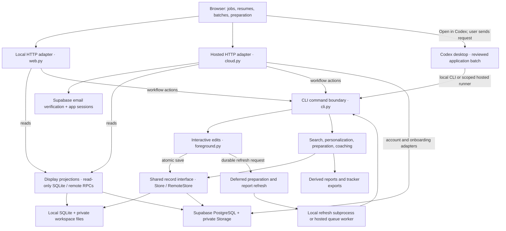

# Agentic job search

A job-search workspace with a web application, a CLI, and four coordinated agent workflows: job discovery, relationships and personalization, interview preparation, and daily coaching. Run privately on your computer with SQLite, or use the invite-only hosted application with Supabase persistence and a separate scheduled worker. Both modes share the same workflow and record model. Markdown reports and editable JSON/CSV trackers remain available alongside the web interface.

[Quick start](#start-here) · [Web application](#web-application) · [Architecture](#architecture) · [Deployment](DEPLOYMENT.md) · [Verification](#verification)

## Start here

From a checkout, Python 3.9+ on macOS/Linux is sufficient for the CLI and local web server; the Python runtime uses only the standard library. Browser libraries, fonts, and artwork are bundled, so serving the web app requires no Node build or CDN-hosted application code. Node is needed only for the JavaScript tests.

```sh
python3 -m jobflow init
# Edit config/profile.json and config/settings.json with your own evidence/preferences.
python3 -m jobflow run
python3 -m jobflow jobs --limit 20
python3 -m jobflow export
python3 -m jobflow web --open
```

Open `reports/review.md` for opportunities and personalized packets, `reports/daily_coach.md` for goals, progress and learning materials, `reports/preparation.md` for the daily plan, and `inputs/tracker/` for editable tracking files. The CLI runs from anywhere using the package's repository directory; `--root /absolute/path` can select another initialized workspace.

The review shows only matching roles, grouped alphabetically by company and ranked within each company, with no 100-role limit. Its company index links to matching-only views in `reports/companies/`. Matching listings marked missing remain visible for rechecking; closed and nonmatching listings remain in `reports/jobs.json` as history. Company views regenerate with the review and do not change your search preferences.

Each listing includes a Levels.fyi salary-reference link. Verified company and role pages are saved as dated `levels_fyi_company_reference` research records. A level-specific page is used only when a literal grade in the job title matches a verified Levels.fyi level or alias; generic Senior/Staff titles and experience requirements do not establish an internal grade. Otherwise the link shows all levels, company-wide salaries, or the company directory when no page has been verified. These are reported compensation benchmarks, separate from the employer's advertised pay, and do not change scoring or compensation fields. Reports derive the links from research on every regeneration, including the daily GitHub export.

Private configuration is in `config/settings.json` and `config/profile.json`. They, database files, inputs, and reports are ignored by Git. A new checkout can copy the examples with `init`; replace the example evidence before use.

## Web application

```sh
python3 -m jobflow web --open
```

The desktop-first application opens at `http://127.0.0.1:8765` and reads your existing SQLite workspace. It includes job search and filters, a daily inbox, company trends, a Bay Area map, a batch application queue, application follow-ups, relationship evidence, and interview preparation. The layout also adapts to phone screens. Use `--port 8766` to choose another port, or `--root /absolute/workspace` before `web` to select another dataset.

The interface uses the existing CLI to persist changes. **Application batches** supports grouped roles, private resume uploads, and a reusable Codex browser workflow. Select a batch, review its materials, and choose **Open in Codex**. The desktop app opens the prepared request; press Send once to start. Local runs use this project. Hosted runs use an expiring connection to the selected batch, download verified private resumes, and sync progress back to the hosted workspace; see [the hosted workflow](HOSTED_CODEX_APPLICATIONS.md). Codex handles the employer pages, asks for missing answers, and records actual submission confirmations. See [the Codex application workflow](CODEX_APPLICATIONS.md). The former browser extension is retired; prior records and uncertain outcomes remain intact. Opening employer links does not record a submission; use the explicit application-stage controls for applications completed manually. Every role's **Interview prep** view includes a role/company preparation guide without requiring a saved application or interview date. The view also keeps shared daily practice visible alongside role and company tasks, within the same daily budget. Remote phone access requires a private hosting or tunneling setup; starting this loopback server does not publish your data. See [the web app guide](WEB_APP.md) for usage, data boundaries, and deployment considerations.

**Resumes** connects onboarding uploads, saved applicant details, and application materials in one private library. Open **Review PDF** to render a saved resume, select text, add anchored edits or comments, and review job-specific suggestions. Accept, reject, or revise proposals, preview the result, and save a separate PDF version for applications. The original stays intact; the new PDF uses a clean layout that may differ from the source. Local suggestions work without a model key; optional AI rewriting requires explicit configuration and a separate send confirmation. Text drafts can also be saved as DOCX. **Plan my next steps** proposes role guidance and a budget-aware schedule for review before applying changes, retaining completed work and notes.

**My account** is always available in the top bar, locally and when hosted. It brings together your professional profile, contact details, resume versions and default resume, search preferences, and searchable application history. Switch between applied roles, saved roles, and all tracked records; unrecorded submission dates remain unknown. Use the links to manage resumes, edit contact details, or update application progress.

Preparation guides explain each exercise's role relevance and link to verified public LeetCode problems. Role links retain their selection across reloads. The **Account context** section displays dated browser observations and imported context from LeetCode, Blind, 1Point3Acres, and LinkedIn; these snapshots are separate from a live API connection and do not require storing provider credentials.

Verified employer addresses can be imported as `company_location` research records and shown as sourced office references or explicit posting-confirmed worksites. Coordinates retain their source and precision, and the original job location text and discovery history remain unchanged. See [employer address evidence](WEB_APP.md#employer-address-evidence) for the import schema.

## Architecture

The application is a Python service with a static HTML/CSS/JavaScript client. The browser reads API projections and sends explicit commands; workflow record actions pass through the CLI. The hosted HTTP adapter separately handles authentication, account/onboarding configuration, uploads, and queue requests through their storage adapters. The four agents are cooperating workflow modules that exchange durable records, not four independently deployed services. Model calls are optional.



### Runtime and storage

| Concern | Local workspace | Hosted Supabase mode |
| --- | --- | --- |
| Entry point | `python3 -m jobflow web --open`; loopback by default | `deploy/start.py` behind HTTPS; `cloud.py` adds account routing and onboarding |
| Canonical state | `data/jobflow.sqlite3`, using SQLite WAL, plus private workspace files | PostgreSQL records, accounts, sessions, run history, queue, and file manifests; private Storage for file bytes |
| Storage implementation | `storage.Store` and local filesystem | `remote_store.RemoteStore`, `remote_accounts.py`, `remote_jobs.py`, and `remote_files.py`, selected through the Supabase backend and workspace context |
| Identity | One selected local workspace | Invitation plus verified email; browser-bound email-link sign-in, optional email codes, opaque application session cookies and CSRF checks |
| Background work | Due-aware CLI runs from an external scheduler; `local_refresh.py` handles pending derived refreshes while the web server runs | Separate `deploy/worker.py` process drains the durable queue and checks due work; the checked-in Render cron runs at minutes 7, 22, 37 and 52 |
| Local disk | Durable user workspace | `/tmp/jobflow` is disposable cache; neither Render service needs a persistent disk |

Hosted private tables live in the unexposed `jobflow_private` schema. The Python backend calls service-role-only RPCs; the browser does not receive the secret key or directly query private tables or Storage. Resume versions and other private artifacts use immutable content-hashed objects with verified downloads. A disk-backed hosted pilot is also supported for a single persistent host; the checked-in [Render Blueprint](render.yaml) selects Supabase and a separate worker.

### Saves, background work, and consistency

1. **Read:** API requests return display projections from the selected account/workspace. Initial job lists omit full descriptions and packet bodies; details load separately. Hosted display pagination can span committed revisions, while durable commands reread and validate their inputs.
2. **Save:** Allowlisted application, task, interview, batch-material, and resume-review edits run through `python3 -m jobflow action --request FILE`. They buffer changes and commit a short compare-and-set transaction against the records and collection membership they read. A save acknowledgement follows the committed primary records and does not wait for a feed search or report export.
3. **Refresh:** Application, task, and interview edits record a durable refresh request. Locally, the web server checks the marker every two seconds and starts the `refresh` CLI in a subprocess. Supabase enqueues the refresh in the same transaction as the edit; the scheduled worker processes it later. Reports and preparation views therefore have eventual freshness, separate from save success.
4. **Run workflows:** Ingestion, configuration changes, planning, and other operations outside the foreground allowlist retain the workflow lock or renewable hosted workspace lease. Background writes to shared user records check their observed state so an older plan cannot overwrite a newly completed task or note. Network failures with uncertain outcomes are not automatically replayed as new mutations.

Search builds source-ownership and canonical-URL indexes from one saved-job scan, fetches up to three feeds concurrently, and batches writes. Matching signatures reuse scores when the role, profile, and preferences are unchanged. Only successful complete source scans advance omission tracking; failed feeds never establish closure. See [performance and concurrent editing](PERFORMANCE.md) for measurements, limitations, and rollout checks. The initial state response is still substantial, and hosted refreshes can wait for the next cron check.

### Application and resume workflows

Application batches reserve selected roles and resume versions before a Codex run. **Open in Codex** prepares a request for the user to send. Local runs use the CLI; hosted runs receive an expiring capability bound to the account, workspace, run, selected roles, and resume hashes. The hosted runner validates that scope on every operation and verifies downloaded resume bytes. Actual submission confirmations are recorded as evidence; uncertain outcomes remain review items and are not retried automatically. The older browser extension remains in the source for compatibility and history but is retired from the current application flow.

Resume onboarding, text drafts, PDF annotations, proposals, and generated versions share the private resume library. Browser PDF rendering and PDF generation use vendored PDF.js and pdf-lib. Saving a revised PDF creates a separate version; original files and evidence remain intact. Optional AI rewriting has its own configuration and explicit send confirmation. Account context imported from LinkedIn, LeetCode, Blind, or 1Point3Acres is dated evidence, not a live account integration.

### Code map and operating boundaries

| Area | Main files |
| --- | --- |
| HTTP and browser UI | [`web.py`](jobflow/web.py), [`cloud.py`](jobflow/cloud.py), [`web_assets/`](jobflow/web_assets/) |
| Commands and concurrent saves | [`cli.py`](jobflow/cli.py), [`foreground.py`](jobflow/foreground.py), [`record_concurrency.py`](jobflow/record_concurrency.py), [`local_refresh.py`](jobflow/local_refresh.py) |
| Four workflow modules | [`workflow.py`](jobflow/workflow.py), [`relationships.py`](jobflow/relationships.py), [`preparation.py`](jobflow/preparation.py), [`coaching.py`](jobflow/coaching.py) |
| Identity, queue, and storage | [`storage.py`](jobflow/storage.py), [`cloud_auth.py`](jobflow/cloud_auth.py), [`cloud_accounts.py`](jobflow/cloud_accounts.py), [`cloud_jobs.py`](jobflow/cloud_jobs.py), [`remote_store.py`](jobflow/remote_store.py), [`remote_files.py`](jobflow/remote_files.py) |
| Resumes and guided planning | [`onboarding.py`](jobflow/onboarding.py), [`resumes.py`](jobflow/resumes.py), [`resume_reviews.py`](jobflow/resume_reviews.py), [`resume_ai.py`](jobflow/resume_ai.py), [`agentic.py`](jobflow/agentic.py) |
| Codex application handoff | [`application_batches.py`](jobflow/application_batches.py), [`codex_handoff.py`](jobflow/codex_handoff.py), [`hosted_codex.py`](jobflow/hosted_codex.py), [`hosted_codex_client.py`](jobflow/hosted_codex_client.py) |
| Deployment and schema | [`deploy/`](deploy/), [`render.yaml`](render.yaml), [`supabase/migrations/`](supabase/migrations/), [`tests/sql/`](tests/sql/) |

Private configuration, databases, resumes, inputs, reports, owner migrations, and local `output/` artifacts stay out of Git. Reports are generated views; edit durable records through the CLI or UI. Public job pages, imported resumes, and research are data, never executable agent instructions. Applications and outreach require explicit user authorization; public affiliation does not establish a personal connection, and resume claims must come from recorded evidence.

The [deployment guide](DEPLOYMENT.md) covers invitations, reviewed onboarding, owner adoption, environment variables, migrations, and recovery. Both foreground transaction/file migrations must be applied before deploying this version to an existing hosted workspace. The Blueprint disables automatic deployment, so pushing source does not establish that a live service or schema has been updated. See [ARCHITECTURE.md](ARCHITECTURE.md) for detailed contracts and the roadmap, [WEB_APP.md](WEB_APP.md) for UI/API behavior, and the [local](CODEX_APPLICATIONS.md) and [hosted](HOSTED_CODEX_APPLICATIONS.md) Codex workflow guides for batch operations.

## What each agent does

| Agent | Available now | External inputs or limitations |
|---|---|---|
| Job search | Reads Greenhouse, Ashby, and Lever public feeds; normalizes jobs; deduplicates; applies level/location filters; scores evidence-backed skills; records source failures and job lifecycle | Meta, LinkedIn and Levels.fyi are manual/public-search sources. Import verified postings from those sources; no private scraping adapters are included. |
| Relationships and personalization | Ranks imported contacts; generates position-specific introduction/email drafts; selects and reorders exact resume achievements into a review draft | True direct/mutual connections require your contact records. Optional model web research finds public prospects but does not verify a personal connection or exact hiring-manager responsibility. |
| Interview preparation | Maintains applications/interviews/tasks; builds an editable daily plan; uses deadlines, progress, and a daily capacity; includes official process references and systems-focused practice | Calendar sync is not connected. Company-specific recent research needs the optional research provider or Codex web research. Paid/private interview reports must be supplied through access you already have. |
| Daily coach | Reviews distinct recorded submissions and actual practice time; suggests bounded daily blocks and sourced learning materials; prioritizes recorded upcoming interviews | Progress must be logged. Undated historical records remain unknown; a missing log is not evidence that no work happened. New web discoveries require Codex research or the optional provider. |

Configure public employer feeds with `source-add`; the example configuration contains no subscriptions. A failed source is visibly unhealthy; it never counts as a successful zero-result search. Feed coverage changes over time. After two successful complete scans omit a previously seen job, its status becomes `closed`; the first omission is `missing`, requiring rechecking before applying.

Retry one source with `python3 -m jobflow search --source SOURCE_ID`; repeat `--source` to select several enabled sources. A scoped search updates only those sources' health and lifecycle, retaining other sources' jobs and health. Unknown or disabled IDs fail before ingestion. Omit `--source` to search every enabled source. Public response bodies are bounded to 64 MiB.

Scores are keyword-based triage hints, not an assessment of hiring probability. The baseline intentionally includes unknown compensation: **base salary is never silently treated as TC**. Verified TC, base-only ranges, currency, and uncertainty are separate fields.

## Track applications, interviews, and preparation

Copy a real job ID from `jobs`, then use:

```sh
python3 -m jobflow application JOB_ID --stage applied --notes "Applied through company site"
python3 -m jobflow interview --job JOB_ID --at 2026-11-05T10:00:00-08:00 --round "Technical screen"
python3 -m jobflow task TASK_ID --status done --notes "Solved in 35 minutes; revisit cancellation"
python3 -m jobflow prep
```

Application stages: `saved`, `applied`, `recruiter`, `technical`, `onsite`, `offer`, `rejected`, `withdrawn`. Update an interview with `interview --id EXISTING_ID ...`. Date/time offsets are mandatory; daylight saving time matters. New tasks can be created with a unique ID, `--title`, `--date`, and `--minutes`. `task --status skipped` removes planned effort; infeasible future work is retained as `unscheduled` for review.

For bulk editing:

```sh
python3 -m jobflow export --directory inputs/tracker
# Edit one of applications.csv, interviews.csv, tasks.csv or contacts.csv.
python3 -m jobflow import inputs/tracker/tasks.csv --kind tasks
```

JSON is also supported and retains all metadata. CSV exports include an `_extra` JSON column; leave it intact so stable task identities and interview links survive a round trip. Export before editing; importing upserts records by ID. Removing a row from an import does not delete the stored record. Use statuses to retain history. Reports are regenerated, so edit through CLI/import, not the report files.

Contact rows require `name`, `company`, `profile_url` or `evidence_url`, and `relationship` (`direct`, `mutual`, `public`). A mutual connection additionally requires `via`, the named introducer. Optional `team`, `title`, and `notes` improve ranking. A shared employer, school, or public profile never establishes a referral path.

To import a posting from an aggregate site, save JSON with `company`, `title`, `url`, `description`, `location`, optional `source_id`, and explicit compensation fields, then run `import FILE --kind jobs`. Use the canonical employer URL when possible. Imported jobs are not automatically revalidated or closed; inspect their `last_seen` date. A duplicated aggregator record does not take ownership of an existing authoritative feed record.

## Daily goals and learning coach

Enable or adjust targets while retaining your configured preparation capacity:

```sh
python3 -m jobflow goals --applications 10 --learning-minutes 30 --coding-minutes 30 --system-design-minutes 30
python3 -m jobflow prep --rebalance-daily
python3 -m jobflow coach
```

The example targets total 90 preparation minutes. Applications have a separate estimate of 15 minutes each: 150 application minutes plus 90 preparation minutes is roughly four hours before breaks. These are editable targets and estimates. The coach reports shortfalls when capacity or suitable jobs are insufficient; it never submits applications or inflates the existing preparation budget. A recorded upcoming interview takes priority over the general habit plan.

`prep --rebalance-daily` explicitly adopts the daily routine when there is no upcoming interview. It retains unstarted generated curriculum in a backlog with original dates and notes. Completed, skipped, in-progress and manual tasks remain. Ordinary runs keep this backlog instead of repeatedly adding missed work to today's plan. Review the notes if preserved commitments leave a daily target unplanned.

Record actual progress with unique session IDs; reuse an ID to correct a record:

```sh
python3 -m jobflow activity agent-loop-20261112 --category learning --minutes 30 --date 2026-11-12 --notes "Built a tool loop; tested malformed arguments"
python3 -m jobflow activity graph-20261112 --category coding --minutes 30 --date 2026-11-12 --notes "Cycle detection; revisit disconnected graphs"
python3 -m jobflow activity retries-20261112 --category system_design --minutes 30 --date 2026-11-12 --notes "Explained lost replies and idempotency"
python3 -m jobflow task TASK_ID --status done --actual-minutes 30
python3 -m jobflow coach --date 2026-11-12
```

Use either a task's `--actual-minutes` or a session record for the same work. If both exist, link the session with `activity ... --task TASK_ID`; on the same local date the completed task's actual total takes precedence. A completed task with only planned minutes shows an estimate, not logged time. Set an appropriate task `--category` (`learning`, `coding`, `system_design`) for goal credit. `application ... --stage applied` records the first explicit submission time; later stage changes retain it. Historical imports do not receive invented submission/completion times. Supply `--applied-at` or `--completed-at` with a real offset-bearing timestamp when known. Existing undated history remains uncounted.

Activities export to `inputs/tracker/activities.csv` and JSON; import with `--kind activities`. Metadata, notes and timestamps survive tracker round trips. Daily scorecard snapshots are in `reports/coaching/`; current state is in `reports/daily_coach.md` and `.json`.

Learning recommendations come from sourced `research` records with `kind: "learning_resource"`, `topics`, `observed_at`, `estimated_minutes`, and professional/official `sources`. Start with the [CMU AI Agents course](https://www.cmu-agents.com/) and its [public harness assignment](https://github.com/cmu-agents/assignment-1/blob/main/ASSIGNMENT.md), in small study/build/test milestones. Treat a 30-minute block as one milestone, not a whole assignment. Full integrations may require paid model/cloud services. Generic harness exercises are not claims about xAI or another employer's actual questions. A scheduled Codex coach can discover and import fresh materials, explain their role relevance, review progress, and suggest changes without automatically changing your goals or completion history.

## Optional model-backed research

Public job ingestion, deterministic packets, and scheduling work without credentials. Enable web research by setting `OPENAI_API_KEY` and `OPENAI_MODEL` in your shell environment, then:

```sh
python3 -m jobflow personalize --job JOB_ID --research
python3 -m jobflow prep --research
python3 -m jobflow discover --research
```

Use a model available to your API account that supports Responses web search. No model or API key is assumed, and credentials are never written to this repository. `config/settings.json` caps calls per invocation and output tokens. Calls can incur API charges. The provider uses [Responses web search](https://developers.openai.com/api/docs/guides/tools-web-search), retains sources and usage in SQLite, caches identical prompts for the day, and sends `store: false`. It sends limited public role context; candidate experience is used locally for resume drafts. Web research remains a set of sourced notes for review and cannot inject new resume claims.

Alternatively, Codex can perform web research with connected tools and import sourced notes using `import FILE --kind research`. Each note requires `id`, `text`, and `sources: [{"url": "https://...", "title": "..."}]`; optional `job_id` associates it with a packet. Full research is exported to `reports/research.json` and a readable research report. No key is needed for this route.

## Morning schedule

`config/settings.json` defaults to **8:00 a.m., America/Los_Angeles, every day**. Weekdays use Python numbering (`0` Monday through `6` Sunday). This command checks the configured local day/time and runs at most once per day:

```sh
python3 -m jobflow run --due
```

An external scheduler can check hourly and run this command when due. Change `hour`, `minute`, `days`, and `timezone` in configuration; an hourly heartbeat runs at the first check after that time. Desktop execution requires the host/app to be available, so a sleeping/offline host may run late. For reliable always-on execution, deploy this same command and persistent data directory to an always-on host. The repository itself does not install a system daemon or cron job.

One background workflow holds the lock (or hosted lease); concurrent workflow runs skip safely. Allowlisted interactive saves use their separate short transactions. All completed runs, including partial source failures, are recorded. Run `search` manually to retry failed sources without waiting for the next morning.

## Discovery roadmap

`discover` creates a candidate research brief; `discover --research` finds additional companies with evidence. Subscribe a verified public ATS board using:

```sh
python3 -m jobflow source-add --id example --company Example --kind greenhouse --board example --url https://example.com/careers
```

Automatic subscription is deliberately a later feature, in the roadmap. The proposed policy is in [ARCHITECTURE.md](ARCHITECTURE.md): discover from public job links and technical communities, validate official employer ownership, test the connector, evaluate matched yield, then auto-subscribe within a bounded exploration budget. Feedback on saved/dismissed jobs should improve discovery and ranking over time.

## Verification

```sh
JOBFLOW_BACKEND=local python3 -m unittest discover -s tests -q
# With Node installed, run the browser/worker regression suites:
for test in tests/test_*.js; do node "$test" || exit 1; done
```

The offline suites cover feed parsing and lifecycle, salary/TC separation, matching, evidence-grounded drafts, preparation budgets and history, tracker round trips, HTTP and account isolation, resume/PDF review, Codex batches, concurrent saves, durable refreshes, search caching, and browser interactions. Tests use temporary workspaces, mocked feeds, and fake remote services. Rollback-only hosted database checks live in `tests/sql/` and require a separately configured database. Live feeds, hosted migrations, authentication, Storage permissions, and deployment health need separate verification; offline tests do not establish those outcomes. The optional paid API path is tested with mock responses.

Public adapter references: [Greenhouse Job Board API](https://docs.greenhouse.io/job-board.html), [Ashby public job API](https://developers.ashbyhq.com/docs/public-job-posting-api), [Lever Postings API](https://github.com/lever/postings-api).
